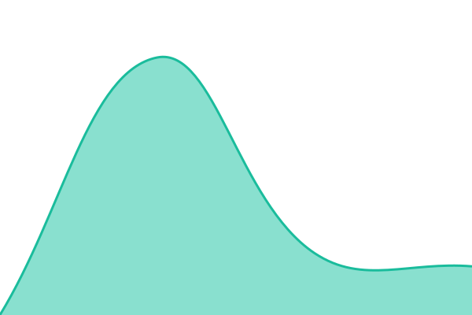
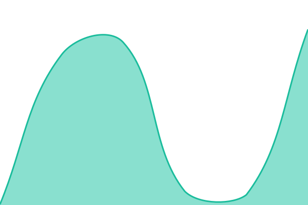

# [📈 Live Status](https://status.nixie.online): <!--live status--> **🟩 All systems operational**

This repository contains the open-source uptime monitor and status page for [8071-HAR0208](https://status.nixie.online), powered by [Upptime](https://github.com/upptime/upptime).

With [Upptime](https://upptime.js.org), you can get your own unlimited and free uptime monitor and status page, powered entirely by a GitHub repository. We use [Issues](https://github.com/8071-HAR0208/status/issues) as incident reports, [Actions](https://github.com/8071-HAR0208/status/actions) as uptime monitors, and [Pages](https://status.nixie.online) for the status page.

<!--start: status pages-->
<!-- This summary is generated by Upptime (https://github.com/upptime/upptime) -->
<!-- Do not edit this manually, your changes will be overwritten -->
<!-- prettier-ignore -->
| URL | Status | History | Response Time | Uptime |
| --- | ------ | ------- | ------------- | ------ |
|  [Website](https://nixie.online) | 🟩 Up | [website.yml](https://github.com/8071-HAR0208/status/commits/HEAD/history/website.yml) | 

 402ms
     
 | 

<a href="https://status.nixie.online/history/website">100.00%</a>
    

|  [Download Server](https://dl.nixie.online) | 🟩 Up | [download-server.yml](https://github.com/8071-HAR0208/status/commits/HEAD/history/download-server.yml) | 

 826ms
     
 | 

<a href="https://status.nixie.online/history/download-server">100.00%</a>
    

|  [GitScrobble](https://gitscrobble.nixie.online) | 🟩 Up | [git-scrobble.yml](https://github.com/8071-HAR0208/status/commits/HEAD/history/git-scrobble.yml) | 

 269ms
     
 | 

<a href="https://status.nixie.online/history/git-scrobble">100.00%</a>
    

|  [No as a Service API](https://naas.api.nixie.online/no) | 🟩 Up | [no-as-a-service-api.yml](https://github.com/8071-HAR0208/status/commits/HEAD/history/no-as-a-service-api.yml) | 

 325ms
     
 | 

<a href="https://status.nixie.online/history/no-as-a-service-api">100.00%</a>
    

|  [Microsoft Key Management Server (KMS](kms.nixie.online) | 🟩 Up | [microsoft-key-management-server-kms.yml](https://github.com/8071-HAR0208/status/commits/HEAD/history/microsoft-key-management-server-kms.yml) | 

 123ms
     
 | 

<a href="https://status.nixie.online/history/microsoft-key-management-server-kms">100.00%</a>
    

<!--end: status pages-->

[**Visit our status website →**](https://status.nixie.online)

## 📄 License

- Powered by: [Upptime](https://github.com/upptime/upptime)
- Code: [MIT](./LICENSE) © [Anand Chowdhary](https://anandchowdhary.com)
- Data in the `./history` directory: [Open Database License](https://opendatacommons.org/licenses/odbl/1-0/)
